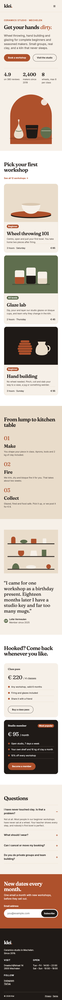
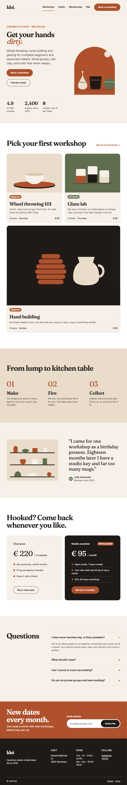
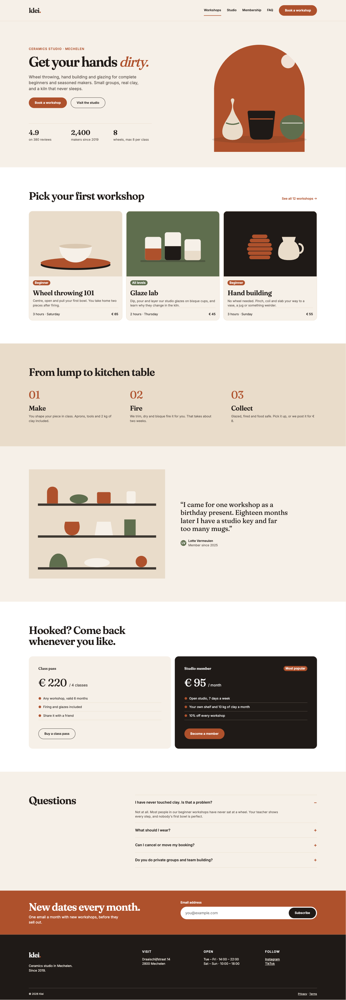
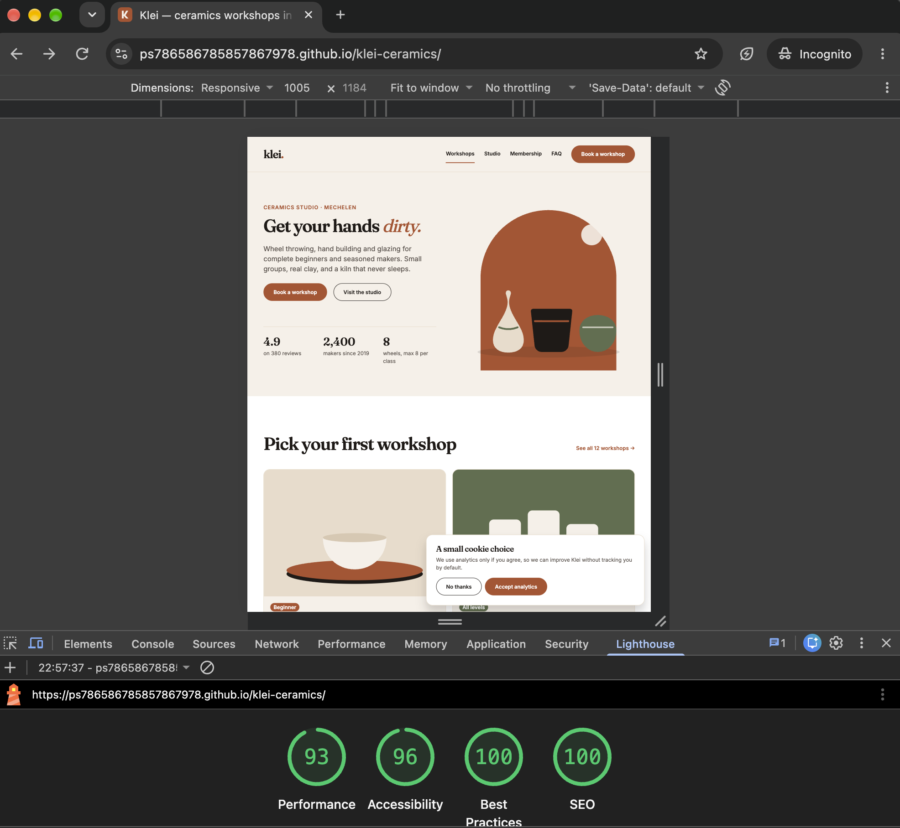
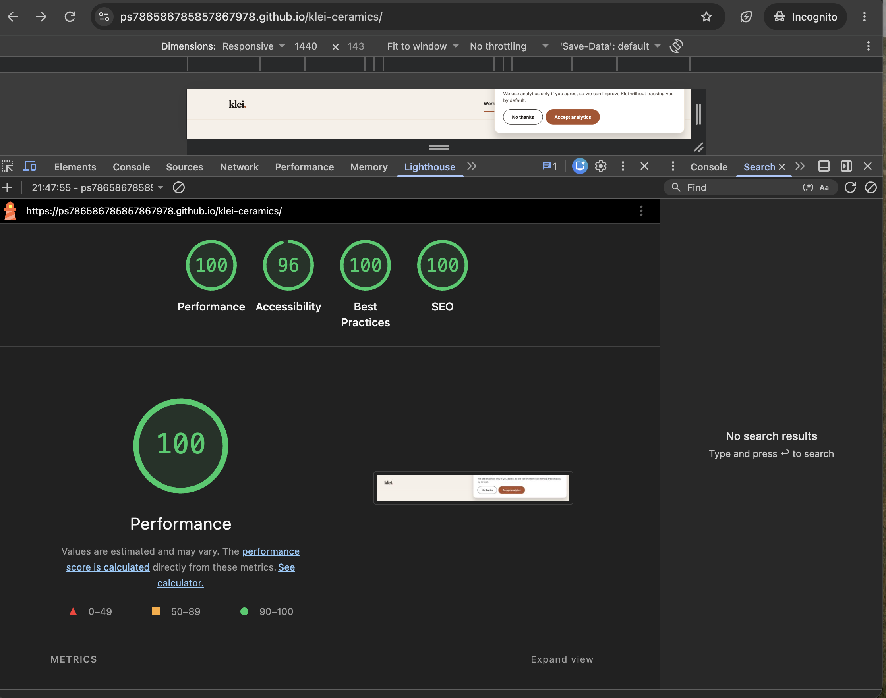
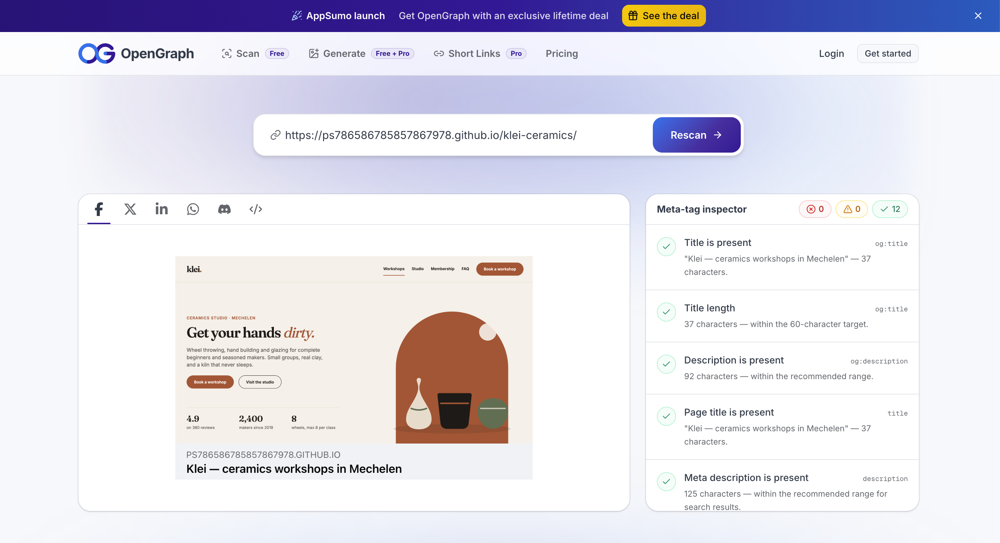

# CHECKLIST.md — the last 30%

AI builds the first 70%. This list is the rest. Tick an item only when you checked it yourself, on a real device where it says so.

Under every category: a prompt to let Codex audit it first. It reports, you decide what gets fixed.

## 1. Detail

- [ ] Spacing, alignment and font sizes match the frames in `design/frames/`
- [x] Fraunces and Inter requested in the right weights with preconnect and `display=swap`
- [x] Only colours from `tokens.css` in the page stylesheet (the favicon is its own SVG asset)
- [ ] Every state from `components.png`: hover, focus, current page, error
- [ ] The real copy from the design, no lorem ipsum

> *Ask Codex:* Compare the page at 375px and 1440px with design/frames/. List every difference in spacing, alignment, type and colour per section. Do not fix anything yet.

## 2. Responsive

- [x] Drag the window from 320 to 1920: nothing breaks, overlaps or jumps
- [ ] No horizontal scroll at any width
- [x] Tablet (768) follows the documented two-column workshop decision
- [x] Tested on your own phone, portrait and landscape

> *Ask Codex:* Check the page at 320, 375, 768, 1024, 1440 and 1920px. Report every overflow, overlap or awkward wrap, with the width where it happens.

## 3. Sizing

- [x] Touch targets are at least 44 × 44px on mobile (buttons, navigation, burger and FAQ)
- [x] Body copy is constrained to short card columns or 38rem maximums
- [x] Heading scale is fluid with `clamp()`
- [x] Supplied SVGs retain their aspect ratios

> *Ask Codex:* List every interactive element smaller than 44×44px on mobile, and every text block wider than 70 characters per line.

## 4. Animation

- [x] Hover and focus transitions on buttons, links and cards
- [x] The mobile menu opens and closes with an animation
- [x] FAQ is native, keyboard-operable, and mutually exclusive
- [x] Subtle opacity/transform reveal on scroll
- [x] `prefers-reduced-motion: reduce` removes animated movement

> *Ask Codex:* Propose micro-interactions for this page: what, which property, duration and easing. Only `transform` and `opacity`. Respect prefers-reduced-motion. Do not implement yet.

## 5. Loading

- [x] Lighthouse Performance ≥ 90 (on the live URL, mobile) — proof: [lighthouse-mobile.png](proof/lighthouse-mobile.png)
- [ ] No layout shift while loading: images and fonts have reserved space
- [x] Fonts: `preconnect` + `display=swap`
- [x] Below-the-fold studio illustration: `loading="lazy"`
- [ ] Nothing loaded that is not used

> *Ask Codex:* Run a performance audit: what blocks rendering, what shifts the layout, what is loaded but not used? Report first.

## 6. Meta & sharing

- [x] Specific `<title>` and `<meta name="description">`
- [x] Open Graph title, description, image and URL metadata supplied
- [x] SVG favicon and `theme-color`
- [x] `<html lang="en">`
- [x] Share preview tested: paste the live URL in WhatsApp, Slack or [opengraph.xyz](https://www.opengraph.xyz/) — proof: [share-preview.png](proof/share-preview.png)

> *Ask Codex:* Audit the head of index.html for SEO and social sharing. What is missing or generic?

## 7. Analytics

- [x] Google Analytics 4 installed, with your own Measurement ID — proof: [before consent](proof/ga4-before-consent.png), [after accept](proof/ga4-after-accept.png), [after decline](proof/ga4-after-decline.png)
- [x] Cookie banner prevents analytics loading before acceptance
- [x] Refusal and acceptance are remembered locally
- [x] You see your own visit in GA4 → Realtime — proof: [ga4-realtime.png](proof/ga4-realtime.png)
- [x] In `README.md`: GA4 vs one alternative, pros and cons, 3 sentences

> *Ask Codex:* Add Google Analytics 4 behind a cookie consent banner, with Consent Mode v2: denied by default, granted only after accepting. Explain every line you add.

## 8. Usability

- [x] Keyboard: menu, FAQ and email have native operation and explicit `:focus-visible`
- [x] The email field: a label, a clear error message, a clear success state
- [ ] Every link goes somewhere (or is clearly not a link)
- [x] Lighthouse Accessibility, Best Practices and SEO ≥ 95 — proof: [lighthouse-mobile.png](proof/lighthouse-mobile.png)
- [x] Someone else tested it on their phone, and you fixed what they found

> *Ask Codex:* Walk through the page with the keyboard only, using the Playwright MCP. Report every place where focus is invisible, trapped or lost.

## Proof

Responsive screenshots:

Lighthouse (live URL):

Share preview:

